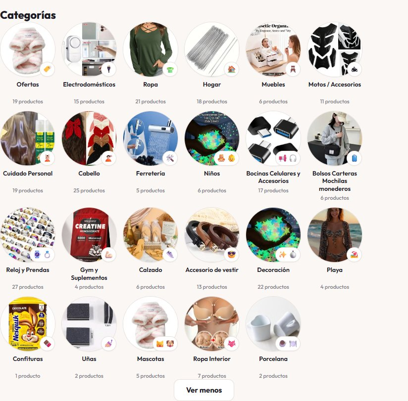
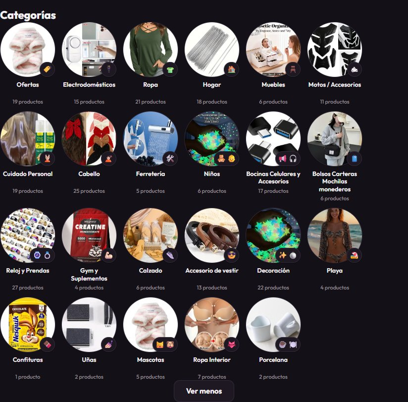
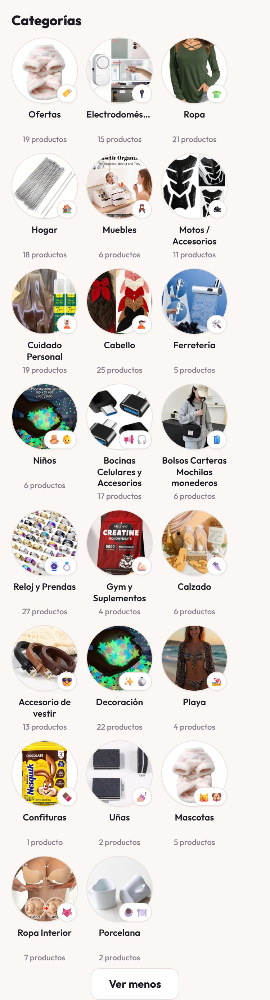
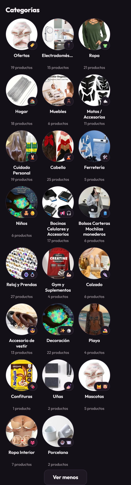

# Tipografía Outfit en toda la tienda 3B — informe de relevo (2026-10-11)

Plan ejecutado: `docs/superpowers/plans/2026-10-11-tipografia-outfit-tienda.md`. Pedido del dueño: los
nombres de las categorías "se ven primitivos". Alcance aprobado: toda la tienda.

## Qué se cambió

- `fuentes/outfit-latin-v15.woff2` (nuevo): Outfit variable, subset latin, OFL 1.1. **32.292 bytes**,
  cabecera `wOF2` verificada.
- `estilos.css`: `@font-face`, token `--fuente`, `body{font-family:var(--fuente)}`, nombre de categoría
  a 12,5px / peso 600, y el emoji del renglón del nombre pasa a insignia sobre el círculo.
- `app.js` (`renderCategorias3D`): el emoji sale de `.cat3d-nombre` y es hijo de `.cat3d-inner`;
  `c.e ?` evita insignia vacía y `escapeHtml(c.e)` lo escapa.
- `index.html` y `taxi.html`: `<link rel="preload">` de la fuente (con `crossorigin`), fuera de los marcadores `og:`.
- NO se tocó: CSP (`vercel.json`, `_headers`), `catalogo.json`, `.logo-mono`/`.logo-word`.

## Correcciones que el plan no preveía (halladas al mirar en el navegador)

El plan acertó en casi todo, pero al aplicarlo tal cual salieron cuatro fallos reales. Los cuatro se
reprodujeron, se corrigieron con CSS mínimo y se volvieron a medir (commit `5fd2cab`):

1. **Círculo estirado (112x148):** con `overflow:visible` en `.cat3d-inner`, el mínimo automático de un
   cuadro con `aspect-ratio` deja de ser 0 y una foto vertical lo estira. Arreglo: `min-height:0`.
2. **Fotos cuadradas:** `.cat3d-foto` es un `<span>` (inline) y `overflow`/`border-radius` no recortan en
   inline. El plan ponía el recorte ahí pero faltaba `display:block`.
3. **Insignia rota con dos emojis:** 6 categorías llevan dos (Niños, Bocinas, Reloj, Decoración,
   Mascotas, Porcelana). Con ancho fijo de 26/30px el segundo emoji se partía a otro renglón y caía fuera
   de la insignia (texto de 34px de alto en una caja de 30). Arreglo: `min-width` + `white-space:nowrap` +
   `border-radius:999px`: con un emoji sigue siendo círculo; con dos, píldora (51x30 escritorio, 46x26 móvil).
   **Decisión de diseño tomada por el ejecutor** (alternativa: mostrar solo el primer emoji). Reversible.
4. **Controles de formulario seguían en Arial:** el buscador, el carrito, los botones de cerrar y todos los
   `input/select/button` de `/taxi` (8 en la tienda y 12 en taxi) no heredan la fuente por defecto. Arreglo:
   `button,input,select,textarea{font-family:inherit}`. Medido después: 0 de 295 y 0 de 15 fuera de Outfit.

## Evidencia (observada)

- `document.fonts.check('600 12.5px Outfit')` -> **true** (`Outfit loaded`); el archivo se sirve 200 `font/woff2`, 32292 bytes.
- `node --test`: tests 36, pass 36, fail 0.
- Capturas (sección Categorías expandida con "Ver todas", las 23 tarjetas):
  - 
  - 
  - 
  - 
- Hechas con Puppeteer (Chrome del sistema) emulando `prefers-color-scheme`; el servidor de usar y tirar vive en el scratchpad, no en el repo.
- Medido en las 4 combinaciones: círculos 112x112 (escritorio) / 92x92 (móvil), `border-radius:50%` en la foto,
  insignia sin recortar por ningún ancestro, ningún nombre truncado en vertical, filas alineadas, sin scroll
  horizontal, categoría activa (clic en "Hogar") con aro y nombre en `--brand` (claro `#7A2E5D`, oscuro `#E9A8CE`).

## Lista de comprobaciones de la Tarea 6

1. Insignia entera: OK (tras la corrección 3). 2. Foto redonda: OK (tras 1 y 2). 3. "Bocinas…" y "Bolsos…" sin
puntos suspensivos: OK. 4. Tarjetas alineadas: OK. 5. Categoría activa: OK (medido por estilos; no hay captura). 6. Insignia
en oscuro: OK. 7. En 375px no tapa media foto: OK (14% del círculo como máximo). 8. Barra, precios y botones en Outfit: OK
tras la corrección 4 (se miró portada y parrilla). 9. `/taxi`: OK (formulario en Outfit, sin desbordes; revisado en 375px).

## Observaciones fuera de alcance (no se tocaron)

- **"Electrodomésticos" se corta con "…" en 375px** (una sola palabra de 104,7px en 92px). **Ya se cortaba antes**
  (94,2px con la letra vieja a 11px/700), no es regresión.
- Una foto de producto de Cloudinary da 404 (`.../b83asoaayqn2wofqhwf0.jpg`): viene de `catalogo.json`, anterior a este cambio.
- El servidor del plan manda `/taxi` (sin extensión) a `index.html`; para ver el taxi en local se usa `/taxi.html`.
- Las insignias de un emoji miden 31x30 (no 30x30) en escritorio: 1px de píldora, imperceptible.

## Publicado y verificado en producción (2026-10-11, tras el informe de arriba)

Ruth autorizó el `git push`. El push fue **rechazado la primera vez**: Stock+ había publicado cuatro veces
`catalogo.json` en el remoto durante la sesión (commits automáticos `catalogo: 24N productos`). Se resolvió con
`git pull --rebase`, que reaplicó los 9 commits locales encima sin un solo conflicto — ninguno toca `catalogo.json`.
**Esto va a repetirse cada vez que se toque la tienda a mano:** el panel escribe directo en el remoto, así que lo normal
es rebasar antes de publicar, no es un problema.

Medido en `https://www.3bqba.com` con el navegador, ya desplegado:

- `/fuentes/outfit-latin-v15.woff2` → **HTTP 200**, `content-type: font/woff2`, **32.292 bytes**. La CSP de Vercel
  **no la bloquea**: era el único riesgo que el servidor local no podía descartar. Cierra el ⚠ de abajo.
- `document.fonts` contiene **`Outfit:loaded`** (la cara cargada de verdad).
- `.cat3d-nombre` computa `Outfit` a **12.5px**.
- `.cat3d-inner` mide **112x112** — el círculo no se estira en producción (la corrección 1 aguanta).
- La insignia mide **31x30** y queda **dentro** del círculo.
- Mirado a ojo: nombres legibles, círculos redondos, insignias enteras, el resto del sitio en Outfit.

### Una trampa del plan, para quien venga

El plan mandaba verificar con `document.fonts.check('600 12.5px Outfit')`. **Esa comprobación da falso positivo:**
se ejecutó contra la versión vieja del sitio, todavía sin `@font-face`, y devolvió **`true`** igualmente (`check()`
responde que sí cuando no hay ninguna cara declarada que contradiga la petición). Si alguna vez hay que comprobar
que una fuente cargó de verdad, usar en su lugar:

```js
[...document.fonts].map(f => f.family + ':' + f.status)   // tiene que salir "Outfit:loaded"
getComputedStyle(document.querySelector('.cat3d-nombre')).fontFamily   // tiene que empezar por Outfit
```

## ⚠ NO VERIFICADO

- Los emojis se dibujan con la fuente de emoji de cada sistema; aquí se vieron con la de Windows/Chrome. En Android/iOS
  el glifo y su ancho cambian, y la píldora de dos emojis puede medir otro tanto. **Es lo único que queda por ver en un
  teléfono de verdad.**
